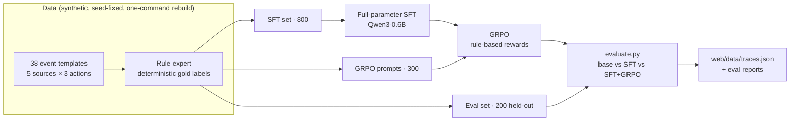
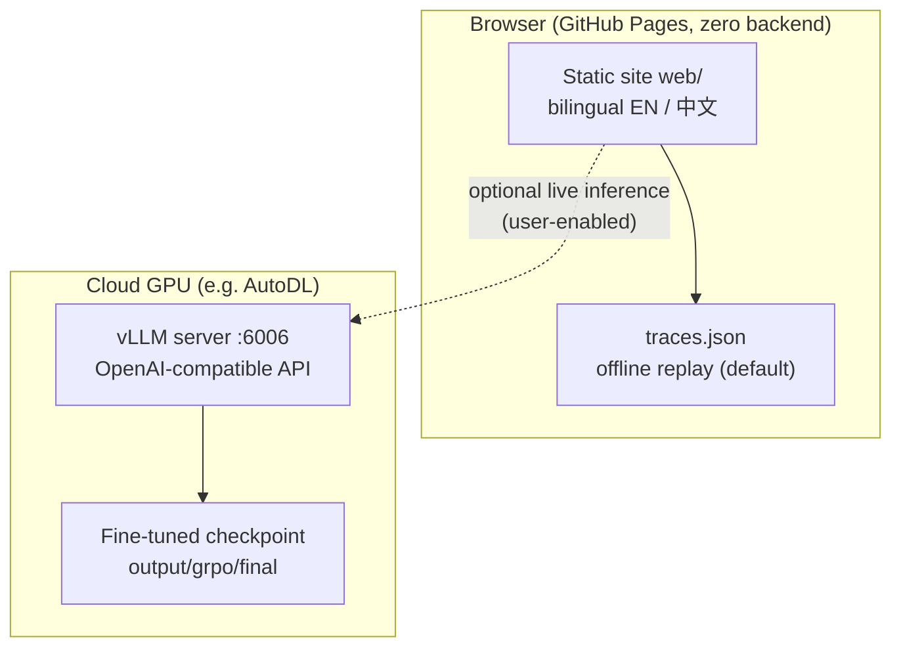
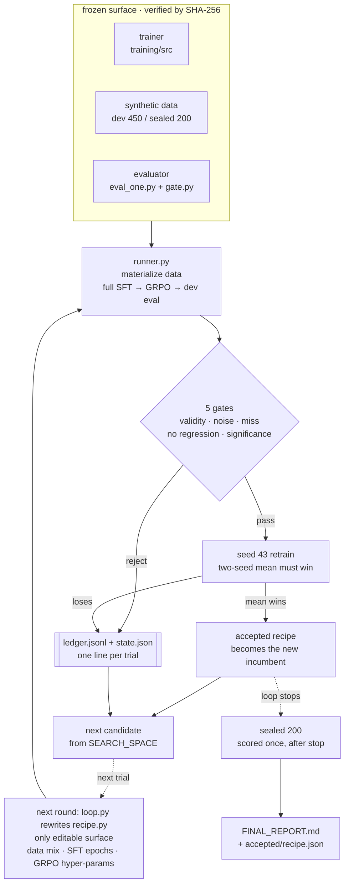

# When to Speak

**English** | [简体中文](README.zh-CN.md)

A reproducible minimal **post-training** demo: fine-tune a small model to decide **when to speak and when to stay silent** in an always-on agent's event stream, then check the result yourself in the browser.

- Base model: Qwen3-0.6B
- Post-training: **full-parameter SFT + GRPO** (TRL, no LoRA, no quantization)
- Inference: **vLLM** (OpenAI-compatible API on a cloud GPU, called directly from the page)
- Delivery: static site + optional remote inference; offline trace replay by default, no local GPU required
- UI: bilingual Chinese/English (top-right toggle, or `?lang=zh` / `?lang=en`)

**Live demo: <https://sanyhe.github.io/when-to-speak/>** — static hosting, no backend, no API key.

## How it works

### Post-training pipeline



### Runtime topology



## Auto Research: a bounded RSI loop

[`autoresearch/`](autoresearch/) is a deliberately narrow version of **recursive self-improvement
(RSI)**: the thing being improved is not the model's code but *the recipe that produces the model*.
A loop proposes a recipe, retrains Qwen3-0.6B from the same base in full, scores it on the same
held-out set, and keeps it only when an external acceptance gate agrees.

It is not a model rewriting its own trainer. The editable surface is one config file, and
everything that could be used to cheat the score is hash-frozen.



Only `recipe.py` is editable. The loop may rewrite it, but everything after that point is either
hash-frozen or decided by an external gate.

| Constraint | Rule |
|---|---|
| Editable surface | only [`autoresearch/recipe.py`](autoresearch/recipe.py) — data mix, SFT epochs, GRPO hyper-parameters |
| Frozen surface | training code, synthetic data, evaluator and both splits, pinned by SHA-256 |
| Judge | dev `macro-F1` on 450 held-out events |
| Gates | JSON validity ≥ 99%, noise ≤ 2%, miss ≤ 2%, no regression, significant gain (paired bootstrap, 2000 resamples) |
| Confirmation | a passing candidate is retrained with `seed=43`; the two-seed mean must still win |
| Sealed set | 200 events, opened once after the loop stops |

One round, one 96 GB GPU, 7 trials, 141 GPU-minutes:

| stage | dev macro-F1 | note |
|---|---|---|
| baseline recipe | 0.9264 | initial incumbent |
| best rejected candidate | 0.9904 | below the accepted recipe, not a significant gain |
| **accepted recipe** | **0.9943** | data mix only: `digest` ×2 + `{deep_work, offline}` ×2 |
| accepted, retrained (`seed=43`) | 0.9923 | two-seed mean 0.9933 |
| **sealed (200 events)** | **0.9828** | precision / recall 1.0, noise 0, miss 0 |

The more useful result is what the loop did **not** get away with: the six rejected candidates
included more RL (`G=16`), a weaker KL penalty (`β=0.02`) and 300 extra boundary samples. None
cleared the significance gate, and the only accepted change was a data-mix edit. In this round the
bottleneck was the acceptance standard, not the model's imagination.

Full record: [`autoresearch/README.md`](autoresearch/README.md) ·
[`autoresearch/FINAL_REPORT.md`](autoresearch/FINAL_REPORT.md).

## Quick start

### Preview the site locally (no GPU)

```bash
# 1. Generate the full dataset and evaluation traces (deterministic mock, no GPU)
python3 training/src/build_dataset.py
python3 training/src/evaluate.py \
  --eval data/synthetic/eval_set.jsonl \
  --models base,sft,sft_grpo \
  --out data/eval/eval_report.json \
  --md-out data/eval/eval_report.md \
  --errors-out data/eval/errors.jsonl \
  --web-out /tmp/traces.json

# 2. Serve the static site
python3 -m http.server 8765 --directory web
# open http://localhost:8765
```

> The committed `web/data/traces.json` holds traces generated by the real fine-tuned weights on a
> cloud GPU (the UI labels it `REAL TRACES`; metrics are in `data/eval/eval_report_hf.json`).
> The mock command above writes to `/tmp` and only validates the pipeline, so it never overwrites
> those real traces. To preview with mock traces instead, point `--web-out` at `web/data/traces.json`.

### Train on a cloud GPU (e.g. AutoDL)

Training does not run locally; it happens on a cloud GPU:

```bash
pip install -r training/requirements.txt
./training/run_all.sh   # dataset -> full-parameter SFT -> GRPO -> real evaluation
```

Command-by-command notes, VRAM estimates and troubleshooting: [docs/en/cloud-training.md](docs/en/cloud-training.md).

### Serve the model with vLLM

After training, start an OpenAI-compatible server on the GPU host:

```bash
./training/src/serve_vllm.sh            # loads output/grpo/final by default, port 6006
```

Open `http://localhost:8765`, fill in the endpoint and model name (default `wts`) in the
"Remote inference (vLLM)" panel, click "Test connection" then "Enable", and switch to the
"vLLM Live" tab to call the remote model in real time. Full steps (AutoDL port mapping, CORS,
troubleshooting) are in [docs/en/cloud-training.md §6](docs/en/cloud-training.md).

## Docs

Each document is available in English (`docs/en/`) and Chinese (`docs/`); both carry a language switcher at the top.

- [docs/en/01-why-when-to-speak.md](docs/en/01-why-when-to-speak.md) — why "when to speak" deserves its own training target
- [docs/en/02-method.md](docs/en/02-method.md) — data contract, rule-based expert, SFT + GRPO
- [docs/en/03-eval.md](docs/en/03-eval.md) — JSON validity, noise rate, miss rate and acceptance criteria
- [docs/en/cloud-training.md](docs/en/cloud-training.md) — cloud GPU runbook
- [AGENTS.md](AGENTS.md) — how this repo is run as harness engineering work (Chinese)

## Project status

| Milestone | Status | Notes |
|---|---|---|
| M1 minimal loop | Done | Data contract, seed set and rule expert ready; full-parameter SFT of Qwen3-0.6B trained on a cloud GPU |
| M2 data + training + eval | Done | 800/300/200 synthetic dataset, SFT + GRPO, real three-model evaluation (macro-F1 SFT 0.899 → GRPO 0.924) |
| M3 web demo | Done | Player, model switching, live metrics, direct vLLM calls; ships real model traces |
| Auto Research (bounded RSI) | Done | One editable recipe file, hash-frozen oracles, 5 acceptance gates, sealed set opened once; dev 0.9264 → 0.9943, sealed 0.9828 |

## Scope

- This stage uses **synthetic data only**; no real email or IM is ingested. Real data would need
  de-identification and would stay local.
- The post-training pipeline is **full-parameter SFT + GRPO**; heavier RL (PPO, multi-turn
  environments) is out of scope for now.

## How this repo is developed

This repo follows **harness engineering** practice: `AGENTS.md` defines the working rules,
`./init.sh` installs dependencies and runs verification, one feature is advanced at a time, and
work without reviewable evidence does not count as done. The feature list and progress notes live
in `private/` (gitignored, not published with the repo).

```bash
./init.sh   # install local deps + run verification (81 tests)
```

## Layout

```
training/       dataset generation, rule expert, full-parameter SFT, GRPO rewards and training, scripts
autoresearch/   unattended recipe search loop (bounded RSI) with frozen oracles and acceptance gates
data/           schema, templates, synthetic data (publishable)
web/            static site and model records
docs/           design and method documents
private/        internal plans and progress (.gitignore excluded, never published)
```

## License

Code and docs are released under [Apache-2.0](./LICENSE). The fine-tuned artifact derives from
Qwen3-0.6B (itself Apache-2.0); keep Qwen's license notice when redistributing weights.
