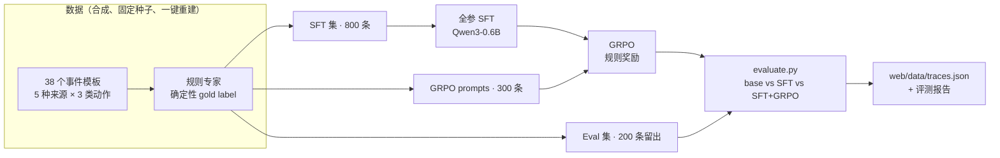
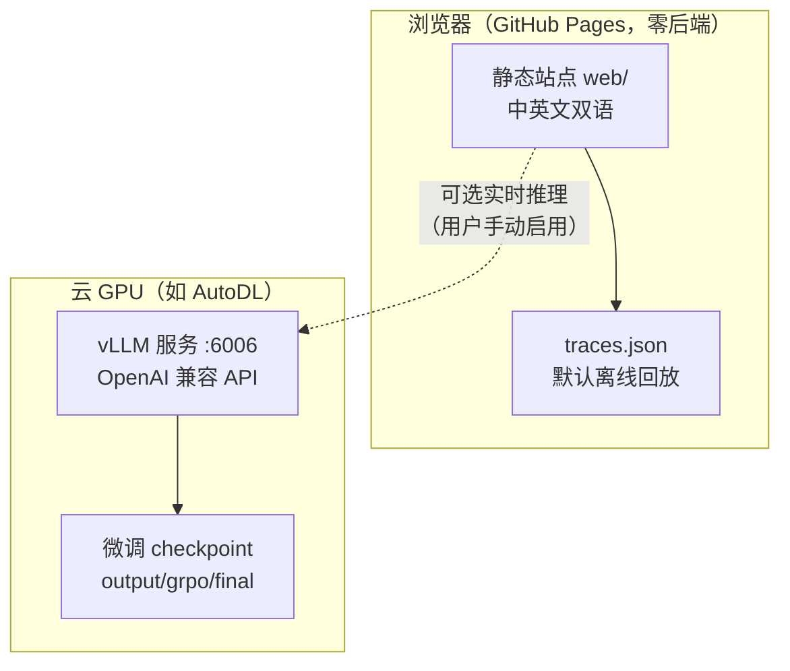
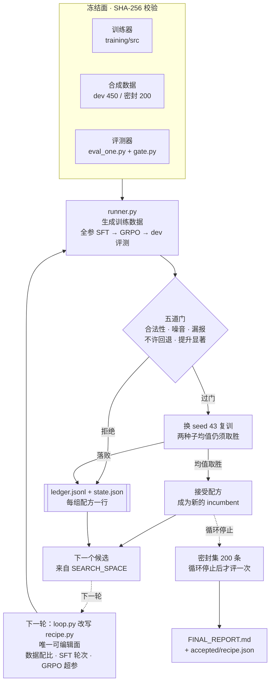

# When to Speak

[English](README.md) | **简体中文**

一个可复现的**后训练（post-training）最小 Demo**：训练一个小模型，在 always-on agent 的事件流中判断"**何时该说话、何时保持静默**"，并在浏览器里亲自验证效果。

- 基座：Qwen3-0.6B
- 后训练：**全参 SFT + GRPO 强化学习**（TRL，无 LoRA / 无量化）
- 推理：**vLLM**（OpenAI 兼容 API，部署在云端 GPU，网页直连调用）
- 交付：静态站点 + 可选远程推理；默认离线回放轨迹，无需本机 GPU
- 界面：中英文双语（右上角按钮切换，或 `?lang=zh` / `?lang=en`）

**在线试玩：<https://sanyhe.github.io/when-to-speak/>**（静态托管，零后端、零 API Key）

## 工作原理

### 后训练流水线



### 运行时拓扑



## Auto Research：一个窄域 RSI 闭环

[`autoresearch/`](autoresearch/) 是一个刻意做窄的**递归自我改进（RSI）**实验：被改进的不是模型代码，
而是**生产模型的训练配方**。循环提出一个配方 → 用同一个基座重跑全参 SFT + GRPO → 在同一份留出集上打分
→ 只有外部验收门点头才保留。

它不是"模型重写自己的训练器"：可编辑面只有一个配方文件，所有可能被用来作弊的东西都被 SHA-256 冻结。



只有 `recipe.py` 可编辑；循环能改写它，但它之后的每一步要么被哈希冻结，要么由外部验收门裁决。

| 约束 | 规则 |
|---|---|
| 可编辑面 | 仅 [`autoresearch/recipe.py`](autoresearch/recipe.py)：数据配比、SFT 轮次、GRPO 超参 |
| 冻结面 | 训练代码、合成数据、评测器、两套数据划分，SHA-256 锁定 |
| 判分 | dev 450 条留出事件的 macro-F1 |
| 五道门 | JSON 合法率 ≥ 99%、噪音 ≤ 2%、漏报 ≤ 2%、不许回退、提升显著（配对 bootstrap 2000 次） |
| 确认 | 过门候选换 `seed=43` 复训，两种子均值仍须胜过现任最优 |
| 密封集 | 200 条，循环停下之后只开一次 |

一轮实验、单张 96GB 卡、7 组配方、141 GPU 分钟：

| 阶段 | dev macro-F1 | 说明 |
|---|---|---|
| 基线配方 | 0.9264 | 初始 incumbent |
| 最好的被拒候选 | 0.9904 | 低于已接受配方，不算显著提升 |
| **被接受的配方** | **0.9943** | 只改数据配比：`digest` ×2 + `{deep_work, offline}` ×2 |
| 接受后换种子复训 | 0.9923 | 两种子均值 0.9933 |
| **密封集（200 条）** | **0.9828** | 精确率 / 召回率 1.0，噪音 0，漏报 0 |

更有用的结果是它**没**做到的部分：6 组被拒候选里包括加大 RL（`G=16`）、放松 KL 约束（`β=0.02`）、
追加 300 条边界样本。它们都没过显著性门，唯一被接受的改动是数据配比——这一轮的瓶颈不在模型的想象力，
而在验收标准。

完整记录见 [`autoresearch/README.zh-CN.md`](autoresearch/README.zh-CN.md) 与
[`autoresearch/FINAL_REPORT.md`](autoresearch/FINAL_REPORT.md)。

## 快速开始

### 本地预览网页（无需 GPU）

```bash
# 1. 生成全量数据 + 评测轨迹（确定性 mock，无需 GPU）
python3 training/src/build_dataset.py
python3 training/src/evaluate.py \
  --eval data/synthetic/eval_set.jsonl \
  --models base,sft,sft_grpo \
  --out data/eval/eval_report.json \
  --md-out data/eval/eval_report.md \
  --errors-out data/eval/errors.jsonl \
  --web-out /tmp/traces.json

# 2. 启动静态站点
python3 -m http.server 8765 --directory web
# 打开 http://localhost:8765
```

> 仓库里的 `web/data/traces.json` 是云端训练后由真实权重生成的轨迹（UI 标注 `REAL TRACES`，
> 指标见 `data/eval/eval_report_hf.json`）。上面的 mock 命令写到 `/tmp`，只用于校验链路，
> 不会覆盖真实轨迹；想用 mock 轨迹预览，把 `--web-out` 改成 `web/data/traces.json` 即可。

### 云端训练（国内 GPU，如 AutoDL）

训练不在本地执行，统一在国内云 GPU 上跑：

```bash
pip install -r training/requirements.txt
./training/run_all.sh   # 数据集 → 全参 SFT → GRPO → 真实评测
```

逐条命令、显存估算与排错见 [docs/cloud-training.md](docs/cloud-training.md)。

### 在线推理（vLLM）

训练完成后，可在 GPU 机器上起一个 OpenAI 兼容的推理服务：

```bash
./training/src/serve_vllm.sh            # 默认加载 output/grpo/final，端口 6006
```

本地网页打开 `http://localhost:8765`，在「远程推理（vLLM）」面板填入服务地址与模型名
（默认 `wts`），点「测试连接」→「启用」，再切到「vLLM Live」标签即可实时调用云端模型。
完整步骤（AutoDL 端口映射、CORS、排错）见 [docs/cloud-training.md §6](docs/cloud-training.md)。

## 文档

每篇文档都有中英两版（`docs/` 中文、`docs/en/` 英文），页面顶部可互相切换。

- [docs/01-why-when-to-speak.md](docs/01-why-when-to-speak.md) — 选题：为什么"何时说话"值得单独训练
- [docs/02-method.md](docs/02-method.md) — 方法：数据契约、规则专家、SFT + GRPO
- [docs/03-eval.md](docs/03-eval.md) — 评测：JSON 合法率 / 噪音率 / 漏报率与验收标准
- [docs/cloud-training.md](docs/cloud-training.md) — 云 GPU 训练运行手册
- [AGENTS.md](AGENTS.md) — 本仓库的 Harness 工作方式（agent 协作规则与 Definition of Done）

## 项目状态

| 里程碑 | 状态 | 说明 |
|---|---|---|
| M1 最小闭环 | 完成 | 数据契约 / 种子集 / 规则专家就绪；Qwen3-0.6B 全参 SFT 已在云 GPU 跑通 |
| M2 数据 + 训练 + 评测 | 完成 | 800/300/200 合成数据集、SFT + GRPO 训练、三模型真实评测（macro-F1 SFT 0.899 → GRPO 0.924） |
| M3 网页 Demo | 完成 | 播放器 / 模型切换 / 实时统计 / 远程 vLLM 直连；已装载真实模型轨迹 |
| Auto Research（窄域 RSI） | 完成 | 只改一个配方文件、oracle 哈希冻结、五道验收门、密封集只开一次；dev 0.9264 → 0.9943，密封集 0.9828 |

## 范围边界

- 本期仅使用**合成数据**，不接入真实邮件/IM；真实数据需脱敏且仅限本地。
- 后训练链路为**全参 SFT + GRPO**；更复杂的 RL（PPO / 多轮环境）为后续阶段。

## 开发方式

本仓库按 **Harness Engineering** 实践维护：`AGENTS.md` 定义工作规则，`./init.sh` 一键安装依赖并跑验证，
一次只推进一个 feature、没有可复核 evidence 不算完成。功能清单与进度记录等内部状态保存在
`private/`（gitignored，不随仓库发布）。

```bash
./init.sh   # 安装本地依赖 + 跑验证（81 项测试）
```

## 目录结构

```
training/      数据生成、规则专家、全参 SFT、GRPO 奖励与训练、一键脚本
autoresearch/  无人值守配方搜索循环（窄域 RSI）：冻结 oracle + 验收门
data/          Schema、模板、合成数据（可公开）
web/           静态站点与 model record（权重指针）
docs/          方案与方法文档
private/       内部方案与进度（.gitignore 排除，不入库）
```

## License

代码与文档以 [Apache-2.0](./LICENSE) 发布。微调产物基于 Qwen3-0.6B
（其本身为 Apache-2.0），分发权重时请保留 Qwen 的许可声明。
